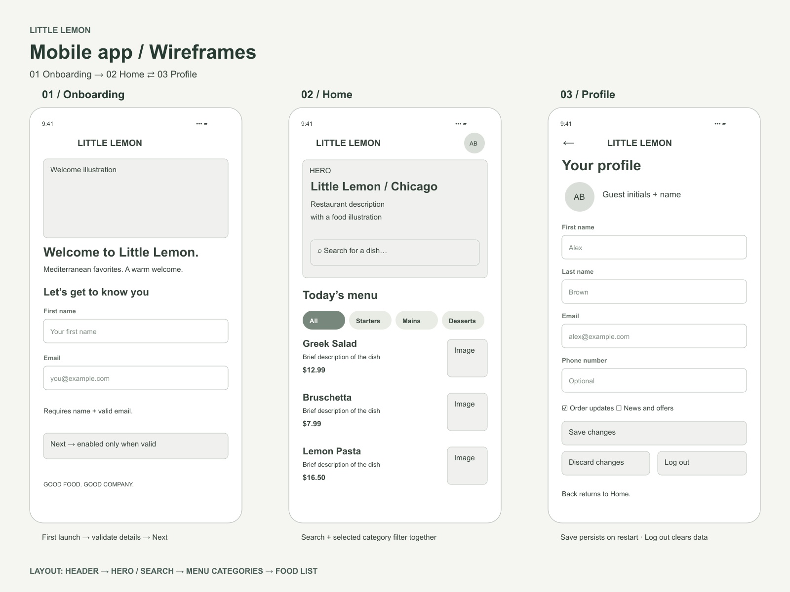

# Little Lemon — React Native Capstone

A complete three-screen restaurant app built with React Native, Expo SDK 57, React Navigation native stack, and AsyncStorage. Includes an editable wireframe and bundled food illustrations, so the menu does not require an API or image server.

## Run the app

Use Node.js 22.13 or newer and npm.

```sh
git clone https://github.com/Tenma24/little-lemon-react-native-capstone.git
cd little-lemon-react-native-capstone
npm ci
npm start
```

Scan the QR code with an Expo Go version compatible with SDK 57. The computer and phone should be on the same network. If the installed Expo Go version does not support this SDK, use an appropriate version from https://expo.dev/go or run the web version below.

```sh
npm run web       # browser preview
npm run android   # requires an Android emulator / device
npm run ios       # requires macOS and an iOS simulator
```

No account, secret, backend, or environment variables are required. Enter any sample first name and valid email, such as `Alex` / `alex@example.com`.

## Wireframe and screenshots

The wireframe was authored as SVG and exported to JPG programmatically. To edit it in Figma, import `design/wireframe.svg`; select the frame and export as JPG if needed. It is not a native Figma project.



- [JPG wireframe](design/wireframe.jpg) — the image for peer review.
- [Editable SVG](design/wireframe.svg).
- [Home screenshot](design/screenshots/home.jpg).
- [Onboarding screenshot](design/screenshots/onboarding.jpg).
- [Profile screenshot](design/screenshots/profile.jpg).

## Rubric coverage

| Requirement | Implementation |
| --- | --- |
| Wireframe | `design/wireframe.jpg` matches the three screen layouts |
| First-launch onboarding | First name and email form shown without a stored profile |
| Next validation | Disabled until a nonblank name and a valid email are entered |
| Home hierarchy | Header, hero, search, category breakdown, food list |
| Profile prefilled | Reads the details saved during onboarding |
| Persistent changes | Save writes the profile and preferences to AsyncStorage |
| Log out | Removes the app's stored profile and resets navigation to onboarding |
| Stack navigation | React Navigation native stack; Profile Back returns to Home |
| Hero | Restaurant description, Chicago location, illustration, search field |
| Categories | All, Starters, Mains, Desserts, Drinks; selected style changes |
| Menu summaries | Name, description, price and locally bundled image |
| Search | Case-insensitive name/ingredient search combined with category filtering |

## Review walkthrough

1. Open the app for the first time. Next is disabled. Try an invalid email: it remains disabled.
2. Enter a first name and valid email. Press Next to open Home.
3. Select Desserts: only Lemon Cake appears. Search `feta` while Desserts is selected: the empty state appears. Press Show all dishes to reset both filters.
4. Open the initials button in the header. Profile contains the onboarding data.
5. Change the last name and email preferences, then Save changes. Restart the app and reopen Profile: the saved values remain.
6. Change a field without saving and press Discard changes: the saved value is restored.
7. Press Back: Home is displayed.
8. Press Log out from Profile, then restart. Onboarding returns with blank fields and disabled Next.

## Validation

```sh
npm test
npx expo install --check
npm run export
```

The project passed four model tests and JavaScript/asset export for Android, iOS and web. Browser UI checks covered onboarding validation, search/category intersection, profile persistence across reload, discard, Back, and logout/reset at a 390×844 mobile viewport. Native device interaction and signed APK/IPA packaging were not tested or produced.

`npm audit` currently reports upstream Expo/Metro tooling advisories (22 total after nonbreaking fixes). The suggested forced fix downgrades Expo to SDK 44 and is incompatible with this project; it was not applied.

## Files

- `App.js`: screens, reusable UI components, navigation and storage lifecycle.
- `src/model.js`: validation, profile normalization, menu data and search.
- `tests/model.test.mjs`: validation and filter tests.
- `assets/`: original bundled illustrations.
- `scripts/design.mjs`: reproducible SVG/JPG artwork generation (`npm run design`).

## Scope and possible improvements

This is a local capstone demo, not a restaurant ordering service. Email preferences are stored locally; no email is sent. Possible next steps include a backend menu, cart and checkout, avatar upload, and automated native-device UI tests. Little Lemon is used as the course's fictional restaurant brand; dish illustrations are original vector artwork created for this project.
